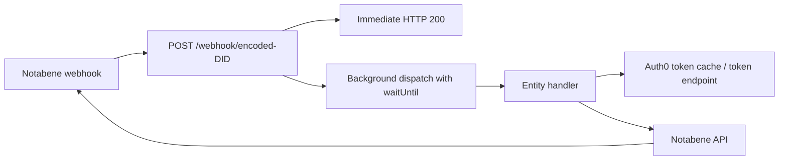

# Architecture and bot behavior

## Request lifecycle

`src/index.ts` accepts JSON and dispatches by `ENTITY_DIDS`. Each handler selects the events it understands. `src/auth.ts` chooses the entity's M2M credentials, requests a client-credentials token from `${AUTH0_ISSUER}/oauth/token` with `AUTH0_AUDIENCE`, and caches it under the entity DID for Auth0's returned `expires_in`. The Cache API is a token optimization, not application storage or a migration dependency.

## Files

| Location | Responsibility |
| --- | --- |
| `src/index.ts` | HTTP entry point, dispatch, authorize/reject/add/replace/settle/flag handlers |
| `src/entities.ts` | DID registry and optional PF key identifier |
| `src/auth.ts` | Entity-to-client credential mapping and token caching |
| `src/handlers/confirm.ts` | Relationship confirmation |
| `src/handlers/request-pii.ts` | Plain-PII receiving bot |
| `src/handlers/request-encrypted-pii.ts` | Encrypted-PII receiving bot; asks Notabene to decrypt |
| `src/handlers/request-pii-from-bot.ts` | Originator bot that supplies synthetic IVMS-101 data |
| `src/client/submit-encrypted-pii.ts` | Helper for an external originator client to encrypt and submit PII |
| `src/crypto/decrypt-pii.ts` | Standalone local decryption functions; not imported by active handlers |
| `src/handlers/beneficiary-pii-request.ts` | Older flow creating a second synthetic transfer; not routed by the current Worker |
| `scripts/generate-pf-pii-key.mjs` | Optional P-256 generator; prints a private key and must be handled securely |
| `test/` | Router, transfer retrieval, presentation, and crypto tests |

## Entity registry

Full DIDs are in `src/entities.ts`; suffixes below are a navigation aid. Credential prefixes mean `<PREFIX>_CLIENT_ID` and `<PREFIX>_CLIENT_SECRET`.

| Registry key / DID suffix | Trigger | Current behavior | Credential prefix |
| --- | --- | --- | --- |
| `accept` / `f2afc…:gr` | `notification.transferCreated` | POST authorize | `ACCEPT` |
| `reject` / `9b030…:de` | `notification.transferCreated` | POST reject with `BENEFICIARY_NOT_FOUND` | `REJECT` |
| `confirm` / `e42f7…:us` | `tap.requireRelationshipConfirmationRequested` | PATCH beneficiary relationship when `confirmCallbackUrl` exists | `CONFIRM` |
| `addCustodian` / `60dbe…:kr` | `notification.transferCreated` | Add a hard-coded custodian | `ADD` |
| `replace` / `8f281…:th` | `tap.requireRelationshipConfirmationRequested` | Replace beneficiary agent with a hard-coded VASP | `REPLACE` |
| `settle` / `did:web:entity.com:two` | `transaction.created` | POST settle; placeholder entity | `AUTH0` |
| `flag` / `did:web:entity.com:three` | `transaction.created` | POST flag; placeholder entity | `AUTH0` |
| `botRequestPII` / `a417f…:be` | Transfer created, relationship requested, presentation satisfied | Observe, confirm relationships, retrieve plain PII | `BOT_REQUESTS_PII` |
| `botRequestsEncryptedPII` / `cef76…:kr` | Same three events | Observe/confirm, retrieve with `decrypt=true` | `BOT_REQUESTS_ENCRYPTED_PII` |
| `requestPIIFromBot` / `36ea1…:in` | Transfer created, relationship requested, presentation requested/partially satisfied/satisfied | Confirm relationships and supply mock PII | `REQUEST_BOT_PII` |
| `br` / `did:web:notabene.id:br` | None routed | Credential mapping exists, no dispatch case | `BR` |

The add-custodian and replacement targets are fixed in `src/index.ts`; changing client IDs does not change them. The confirmation handler uses `confirmCallbackUrl` as a gate, but constructs its own relationship PATCH URL instead of calling that callback.

## Three PII flows

### Bot receives plain PII

The client creates a transfer involving `botRequestPII`. Notabene's externally configured `REQUIRE_PRESENTATION` policy requests PII from the counterparty. On `tap.requirePresentationSatisfied`, the bot fetches `/entities/{entity}/tx/{id}?sanitize=false`. It accepts a direct object or `{ transfer: ... }` wrapper and logs structural metadata, not retrieved PII values. It does not create another transfer.

### Bot receives encrypted PII

The same flow targets `botRequestsEncryptedPII`. The originator client can integrate `submitEncryptedPii()` from `src/client/submit-encrypted-pii.ts`: it encrypts each primitive IVMS-101 leaf as compact ECDH-ES/A256GCM JWE using the webhook's encryption key, then POSTs to the relative presentation callback. This helper is not a Worker endpoint.

On satisfaction, the Worker fetches `/entities/{entity}/tx/{id}?decrypt=true&sanitize=false`. That relies on Notabene having the appropriate hosted key and permissions. The active handler does not use `PF_BOT_PRIVATE_JWK` or `decryptIvms101()`. Confirm the live hosted-key arrangement with the Notabene owner; a purely locally held key is insufficient for this server-decryption route.

The standalone decryption functions and `npm run generate:pf-key` support separate experiments. Do not generate or replace an existing key during repository migration: it will not decrypt data addressed to an old key. The generator prints private material; use a private session and the credential manager, never a committed file or CI log.

### Request PII from the bot

The requesting VASP is the beneficiary and creates a beneficiary-initiated RFI using synthetic settlement data; no real blockchain deposit is required. The originator is `requestPIIFromBot`. Enable the requesting VASP's `REQUIRE_PRESENTATION` policy in Notabene.

Use [`examples/request-pii-from-bot.json`](../examples/request-pii-from-bot.json), replacing both occurrences of `did:web:replace-with-your-vasp.example:test` with the requesting VASP DID. POST it to `https://api.eu1.notabene.id/entities/YOUR_VASP_DID/tx` using that VASP's bearer access token. Keep the token in the API client's secret storage.

Expected sequence: `notification.transferCreated` → `tap.requirePresentationRequested` → bot POSTs synthetic IVMS-101 to `callbackUrl` → requesting VASP receives `tap.requirePresentationSatisfied`. The callback must resolve to the configured Notabene API origin. Relationship events may also occur. Partial satisfaction is logged and requires checking policy requirements.

## Add an entity

1. Add its DID to `src/entities.ts` and dispatch case to `handleEvent()` in `src/index.ts`.
2. Implement event behavior and map credentials in `src/auth.ts`.
3. Add the non-secret client ID to `wrangler.jsonc`, blank secret name to `.dev.vars.example`, and declaration to `src/env.d.ts`.
4. Run `npm run cf-typegen`, typecheck, focused behavior tests, and the full suite.
5. Provision the real secret outside Git; configure permissions, webhook subscriptions, and policies in the external services.
6. Document the expected outcome. A `200` acknowledgment alone does not prove the action succeeded.
